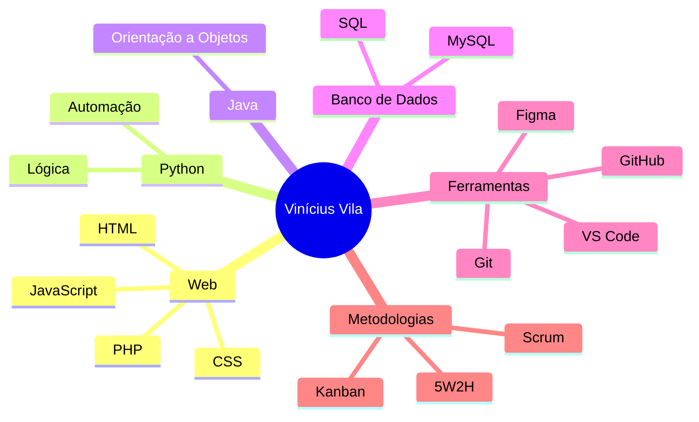
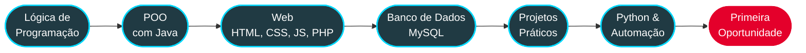

<!-- ===================== HEADER ===================== -->
<div align="center">


<h3>Estudante de Análise e Desenvolvimento de Sistemas</h3>

<p>
  🐍 Python &nbsp;•&nbsp; ☕ Java &nbsp;•&nbsp; ⚡ JavaScript &nbsp;•&nbsp; 🐘 PHP<br>
  <i>Transformando ideias em soluções reais</i>
</p>

<br>

<a href="https://www.linkedin.com/in/vinicius-vila-nova/">
  
</a>
<a href="mailto:ffvini686@gmail.com">
  
</a>
<a href="https://github.com/ViniVila">
  
</a>


<br><br>


</div>


<!-- ===================== SOBRE ===================== -->
<h2 align="center">👨‍💻 Sobre mim</h2>

<p align="center">
Estudante de <b>Análise e Desenvolvimento de Sistemas</b> no <b>SENAI</b>, com foco em programação,<br>
desenvolvimento de software, bancos de dados e desenvolvimento web.<br><br>
Aplico boas práticas como <b>Clean Code</b>, versionamento com <b>Git</b> e documentação em todos os meus projetos,<br>
sempre em busca de soluções eficientes, organizadas e escaláveis.
</p>

```python
class ViniciusVila:
    nome = "Vinícius Vila"
    formacao = "Análise e Desenvolvimento de Sistemas — SENAI"
    linguagens = ["Python", "Java", "JavaScript", "PHP", "HTML", "CSS"]
    banco_de_dados = ["MySQL"]
    ferramentas = ["Git", "GitHub", "VS Code", "Figma"]
    metodologias = ["Scrum", "Kanban", "5W2H"]
    objetivo = "Construir uma carreira sólida em tecnologia"
    status = "Aberto a estágio, trainee e colaborações"

    def frase(self):
        return "Aprendizado contínuo e dedicação são a base do meu crescimento."
```

<div align="center">

| 🎯 Objetivo | 🔭 Foco atual | 💼 Disponibilidade | 🌱 Aprendendo |
|:---:|:---:|:---:|:---:|
| Carreira sólida em tecnologia | Projetos práticos em Python, Java e Web | Estágio, trainee e colaborações | Novas ferramentas e boas práticas |

</div>


<!-- ===================== FORMAÇÃO ===================== -->
<h2 align="center">🎓 Formação</h2>

<div align="center">

| Curso | Instituição | Status |
|:---:|:---:|:---:|
| Análise e Desenvolvimento de Sistemas (ADS) | SENAI | 📚 Em andamento |

</div>

<p align="center">
  <b>Conteúdos estudados:</b> Lógica de Programação • Programação Orientada a Objetos • Banco de Dados • Desenvolvimento Web • Versionamento com Git • Metodologias Ágeis
</p>


<!-- ===================== STACK ===================== -->
<h2 align="center">🛠️ Stack Tecnológica</h2>

<h3 align="center">⌨️ Linguagens</h3>
<p align="center">
  
</p>

<h3 align="center">🗄️ Banco de Dados</h3>
<p align="center">
  
</p>

<h3 align="center">🧰 Ferramentas & Design</h3>
<p align="center">
  
</p>


<!-- ===================== MAPA DE CONHECIMENTO ===================== -->
<h2 align="center">🗺️ Mapa de Conhecimento</h2>




<!-- ===================== ATUAÇÃO ===================== -->
<h2 align="center">🚀 Áreas de Atuação</h2>

<div align="center">

| | Área | O que eu faço |
|:---:|:---|:---|
| 🌐 | **Desenvolvimento Web** | Interfaces responsivas e aplicações modernas com HTML, CSS, JavaScript e PHP |
| 🐍 | **Python & Automação** | Scripts, lógica de programação e automação de rotinas |
| ☕ | **Desenvolvimento de Software** | Programação orientada a objetos com Java, Clean Code e Git/GitHub |
| 🗄️ | **Banco de Dados** | Modelagem, consultas SQL e integração com aplicações usando MySQL |
| 🎨 | **Design de Interfaces** | Protótipos e layouts com Figma, focados em experiência do usuário |

</div>


<!-- ===================== METODOLOGIAS ===================== -->
<h2 align="center">🧠 Metodologias & Produtividade</h2>

<p align="center">
  
  
  
  
  <br>
  
  
  
</p>


<!-- ===================== PROJETOS ===================== -->
<h2 align="center">📌 Projetos em Destaque</h2>

<table align="center">
  <tr>
    <td align="center" width="50%">
      <h3>📁 KEEPER</h3>
      
      
      
      <br><br>
      <a href="https://github.com/ViniVila/KEEPER">
        
      </a>
    </td>
    <td align="center" width="50%">
      <h3>💡 desafio_de_ideias</h3>
      
      
      
      <br><br>
      <a href="https://github.com/ViniVila/desafio_de_ideias">
        
      </a>
    </td>
  </tr>
</table>

<p align="center">
  <a href="https://github.com/ViniVila?tab=repositories">
    
  </a>
</p>


<!-- ===================== ROADMAP ===================== -->
<h2 align="center">🎯 Roadmap de Evolução</h2>



<div align="center">

| Meta | Descrição |
|:---|:---|
| 🐍 **Aprofundar em Python** | Evoluir em lógica, automação e boas práticas na linguagem |
| 🌐 **Projetos Web completos** | Integrar front-end, back-end e banco de dados em aplicações reais |
| 🤝 **Contribuir em projetos** | Colaborar em projetos em equipe e aprender com outros desenvolvedores |
| 💼 **Primeira oportunidade** | Ingressar na área de tecnologia por meio de estágio ou trainee |

</div>


<!-- ===================== COLABORAÇÃO ===================== -->
<h2 align="center">🤝 Vamos colaborar?</h2>

<p align="center">
  Tenho interesse em projetos que envolvam <b>Python</b>, <b>desenvolvimento web</b> e <b>banco de dados</b>.<br>
  Se você busca um desenvolvedor em formação dedicado, ou quer trocar ideias e conhecimento, será um prazer conversar.
</p>


<!-- ===================== CONTATO ===================== -->
<h2 align="center">📫 Contato</h2>

<p align="center">
  <i>"Aprendizado contínuo e dedicação são a base do meu crescimento profissional."</i>
</p>

<p align="center">
  <a href="https://www.linkedin.com/in/vinicius-vila-nova/">
    
  </a>
  <a href="mailto:ffvini686@gmail.com">
    
  </a>
  <a href="https://github.com/ViniVila">
    
  </a>
</p>

<!-- ===================== FOOTER ===================== -->

